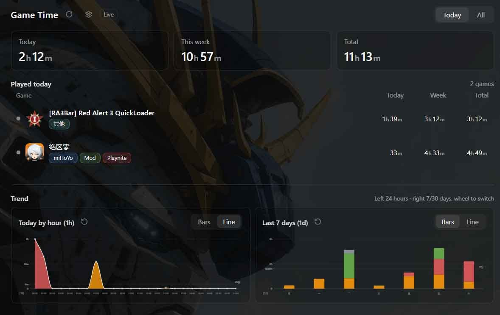
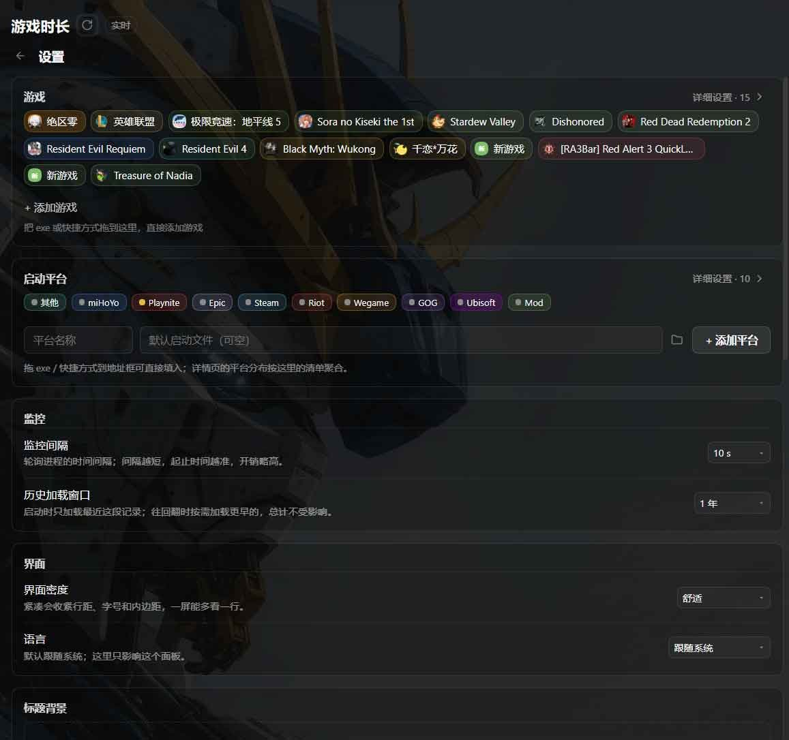
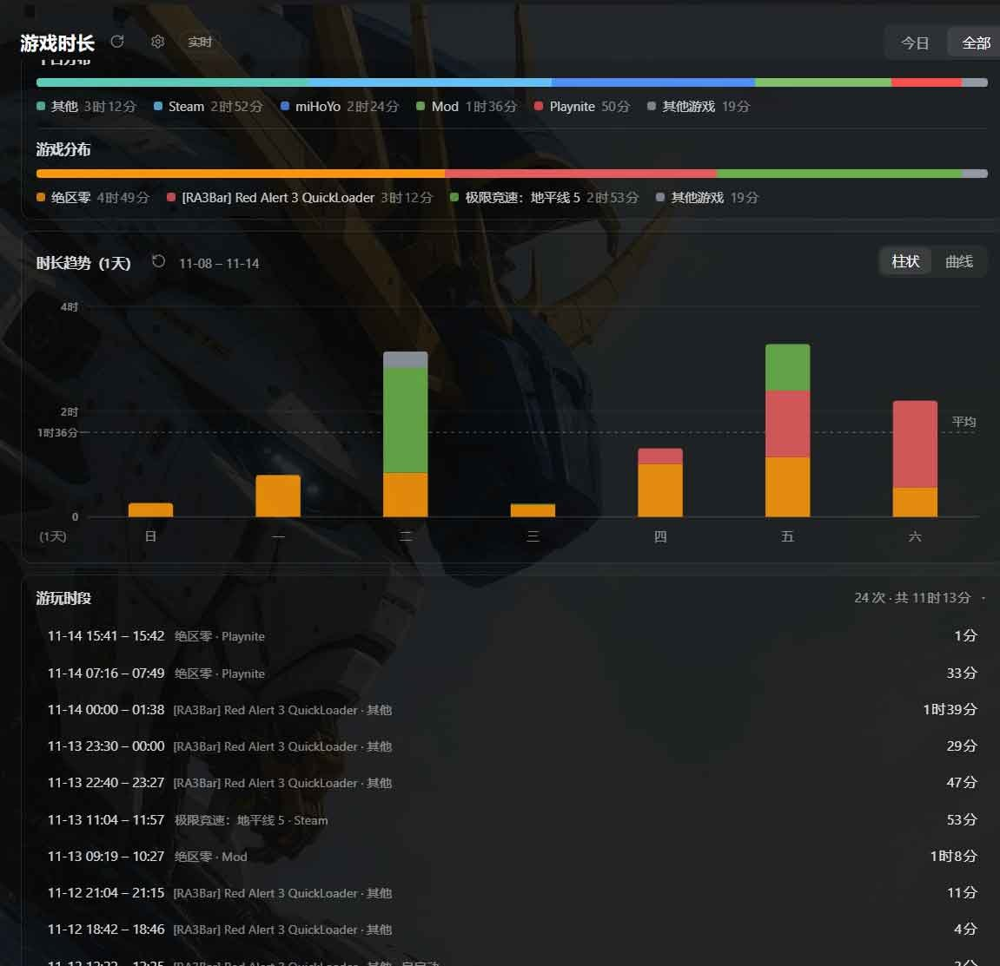
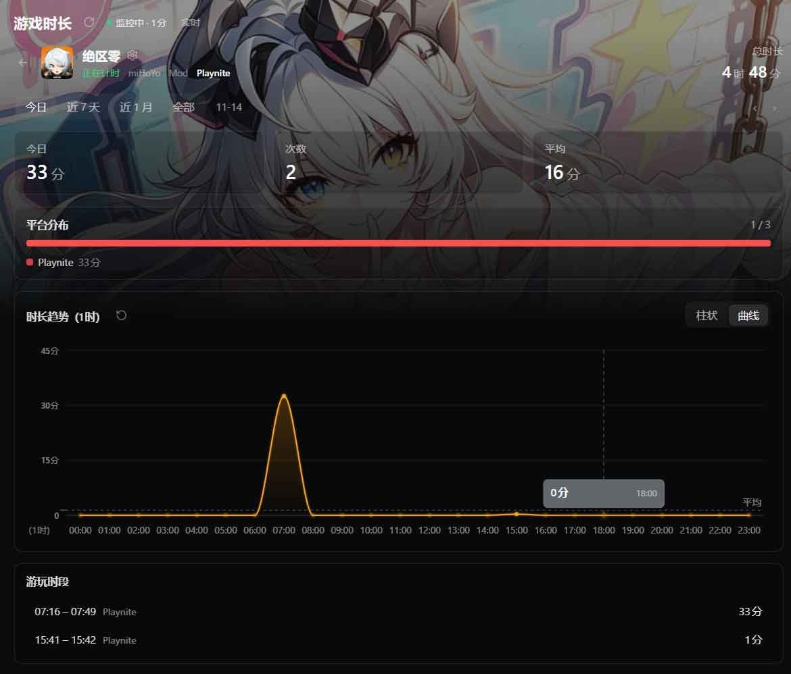

# Game Time

A DSH sidebar panel that tracks how long you actually play: it watches game processes locally and records every session, so you get today, last 7 days, last 30 days and all-time numbers without any cloud account.

> 中文说明见 [README.md](README.md)。

## What it does

- Counts by process, not by launcher, so client updates and launchers don't inflate the numbers.
- Records each session with a start and an end, split at local midnight.
- Games, platforms, per-game backgrounds, icons and colours; archived games fold away.
- Everything stays on this machine under `%USERPROFILE%\.dsh\storages\game-time\`.

## Requirements

- Windows 10/11
- DSH (DeepSeek Harness) with plugin support
- No admin rights, no external service

## Install

**From npm (recommended)**

- Desktop: DSH → Settings → Plugins → search `dsh-plugin-game-time` → install → restart DSH.
- CLI: `dsh plugin --profile <profile> add dsh-plugin-game-time` (the desktop profile is usually `desktop`).

**From the release zip (no npm)**

1. Download [dsh-plugin-game-time.zip](https://github.com/super0plant/dsh-plugin-game-time/releases/latest/download/dsh-plugin-game-time.zip) and unpack it anywhere, e.g. `D:\Tools\dsh-plugin-game-time`.
2. DSH → Settings → Plugins → Add plugin → paste the unpacked folder path.
3. Restart DSH (the host code is loaded once at startup).
4. The **Game Time** icon shows up in the sidebar.

> Keep the folder where it is: the DSH profile stores a link to that path.

## First run

Drop a game's `.exe` or a shortcut anywhere on the today/all-games page. A small dialog asks for a name and a platform — leave the platform on **Other** if you don't care. The status light turns green once the game is detected; it updates every 10 seconds (configurable) and the refresh button updates it immediately.

You do not need to scan your library. Dragging a shortcut or pasting a path is enough.

## The today page

- Summary cards: today, this week, all time.
- The list of games played today.
- A trend module: a 24-hour chart on the left, a 7-day chart on the right that becomes 30 days on the wheel.
- Hover a column for its value; click for the breakdown; click outside to close.
- Each chart remembers its own bar/line choice and the 7/30-day window.

## Settings

| Setting | What it does |
|---|---|
| Polling interval | How often running processes are checked (10 s by default). |
| History window | How much history is loaded at start (1 month to 5 years); older sessions load on demand and totals stay all-time. |
| Density | Comfortable or compact. |
| Language | Follow system, Chinese or English. |
| Row hints | The `avg/day`, `days played` and `vs average` chip is only shown for games played within N days (7 by default). |
| Backgrounds | Panel and header images, cropped per image. |
| Auto-archive | Fold games that have not been played for N days; playing once brings them back. |

## Screenshots

| Today (English UI) | Settings |
|---|---|
|  |  |
| **All games** | **Game detail** |
|  |  |

## Common questions

- **Don't add the launcher.** Add the game itself (`ZenlessZoneZero.exe`), not `launcher.exe`.
- **No desktop icon?** Right-click the shortcut → Properties → Target, or look for the largest exe in the install folder. Shortcuts can be dropped directly.
- **Which process is it?** Keep the game open, check Task Manager → Details, and pick the exe using the most resources.

## Data and privacy

Local files only: `config.json`, `sessions.json`, `active.json` and `presets.json`. Nothing is uploaded. Back up the folder to keep your history; `backup.cmd` / `restore.cmd` do it in one double-click.

## Limitations

- Windows only.
- No automatic library scan — deliberately.
- Process-based timing only: playtime is counted while the process runs, including when the game is in the background.
- The plugin has no cloud sync.

## Why this exists

I just wanted to know how long I'd played Zenless Zone Zero, and how much I play on any given day. I tried Playnite for a while, but it felt heavy and its timing wasn't thorough enough, so I decided to build my own — then kept going until it turned into a fairly complete tracker. It's my first project, so plenty is still rough; I keep revisiting the interaction and the details wherever I can, but I'm one person with limited time.

The code isn't split into modules yet; I'll get there as I get more comfortable. What you see on screen has been gone over several times, and I'm fairly happy with it — I'm a user of my own tool, so I keep using it and keep changing it.

## Author

super0plant · 2026.11.14
